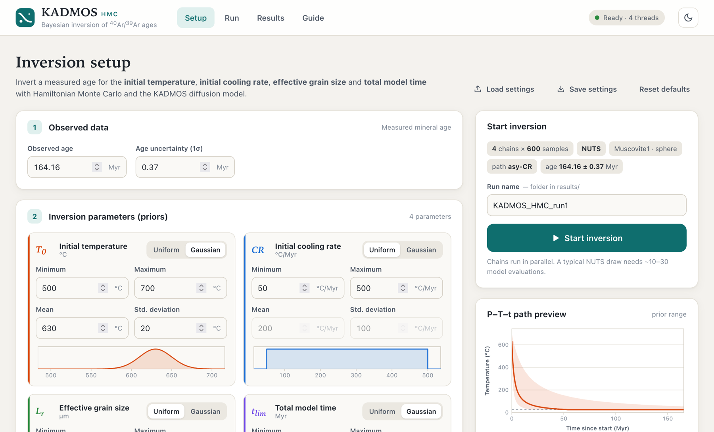
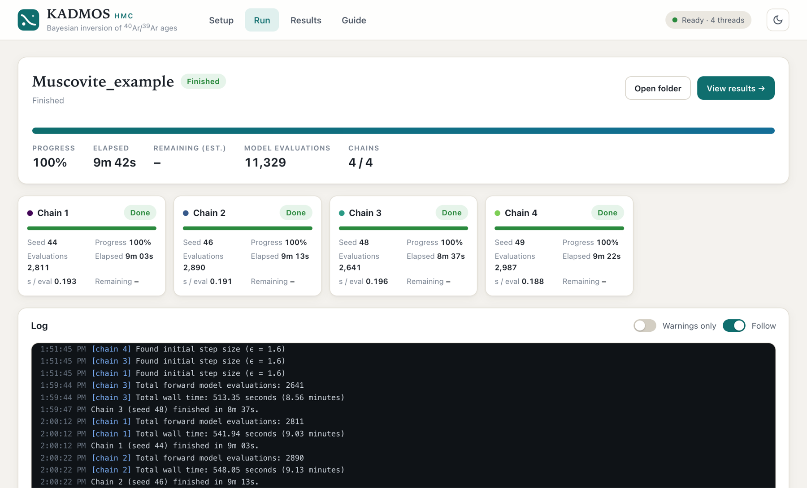
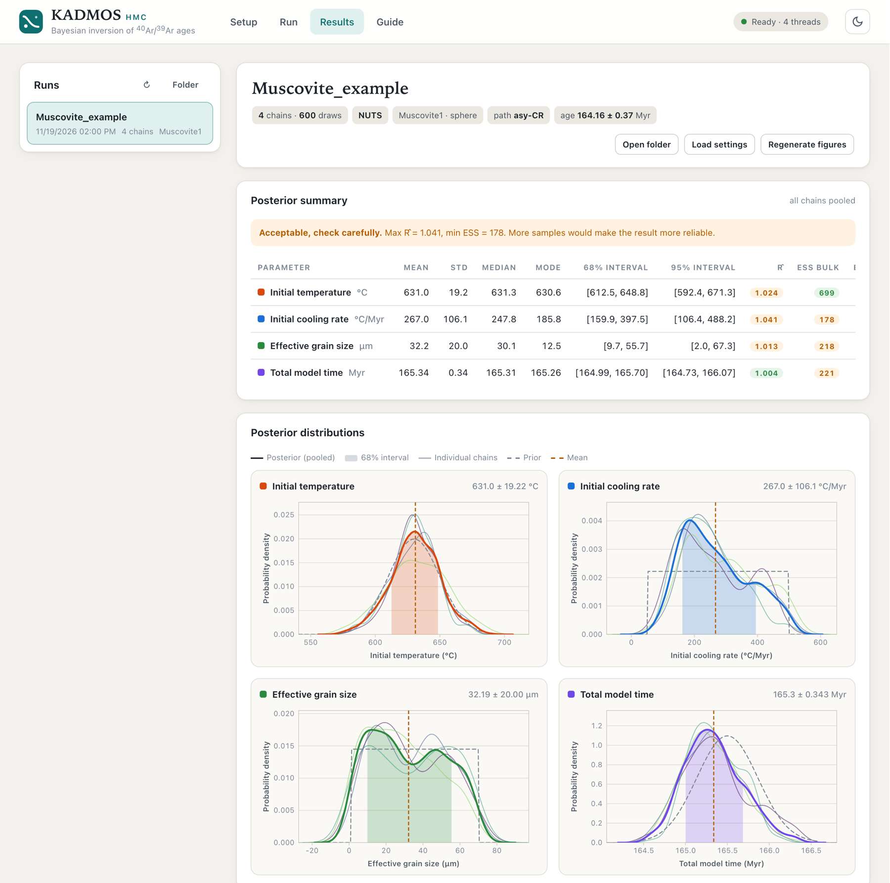
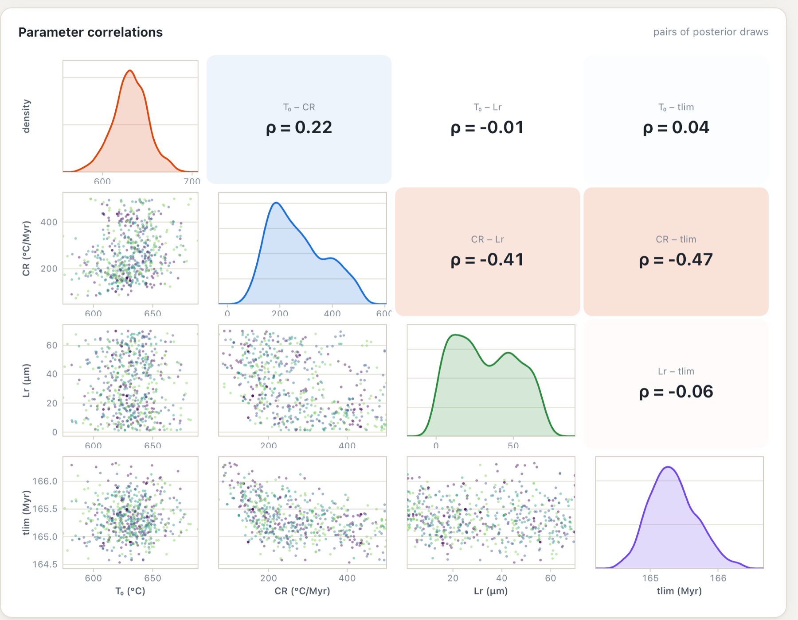

<p align="center">
  
</p>

<h1 align="center">KADMOS HMC App</h1>

<p align="center">
  <b>A graphical interface for Bayesian <sup>40</sup>Ar/<sup>39</sup>Ar thermochronology</b><br>
  KADMOS diffusion model · Hamiltonian Monte Carlo (Turing.jl) · runs in your web browser
</p>

<p align="center">
  
  
  <a href="LICENSE"></a>
  <a href="https://doi.org/10.5281/zenodo.18247900"></a>
</p>

<p align="center">
  
</p>

An interactive interface for the Bayesian inversion of <sup>40</sup>Ar/<sup>39</sup>Ar ages with the
KADMOS diffusion model and Hamiltonian Monte Carlo (Turing.jl).

The inversion estimates four parameters from a measured mineral age:

| Parameter | Symbol | Prior |
|---|---|---|
| Initial temperature | T₀ (°C) | Uniform or truncated Gaussian |
| Initial cooling rate | CR (°C/Myr) | Uniform or truncated Gaussian |
| Effective grain size | Lr (μm) | Uniform or truncated Gaussian |
| Total model time | tlim (Myr) | Uniform or truncated Gaussian (default: Gaussian from e.g. a hornblende age, truncated at ±3σ) |

## Quick start

1. Unzip the `KADMOS_HMC_App` folder anywhere.
2. **Windows:** double-click `KADMOS_App.bat`.
   **macOS:** see [Starting on macOS](#starting-on-macos) (one-time permission, then double-click).
   **Linux:** run `bash kadmos_app.sh` in a terminal.
3. Nothing needs to be installed beforehand. If Julia 1.11 is not on the computer, the launcher
   downloads it (about 250 MB) into a `julia` folder inside the app folder. Nothing is installed
   anywhere else, and no Microsoft Store or administrator rights are needed.
4. The first start downloads and prepares the Julia packages: it needs internet and takes
   about 2 minutes on a fast computer and up to about 10 minutes on a slower one, once.
   Later starts take a few seconds and work offline.
5. The app opens in your web browser. The packages for the PNG/PDF figures are prepared in the
   background while you set up your first run (see [Figures](#figures)).

## Requirements

* Windows 10/11, macOS or Linux, and a web browser
* Internet on the first start (Julia and package download)
* [Julia](https://julialang.org/downloads/) 1.11 — downloaded by the launcher if missing. If a
  Julia 1.11 is already installed (also through Juliaup), the launcher uses it instead.

## Starting the app

* **Windows:** double-click `KADMOS_App.bat`
* **macOS:** double-click `KADMOS_App.command` (after the one-time permission step below)
* **macOS / Linux, in a terminal:** `./kadmos_app.sh` (or `bash kadmos_app.sh`)
* **Any system with Julia 1.11, from a terminal in this folder:**

  ```
  julia --threads=auto,1 --project=. KADMOS_App.jl
  ```

The interface opens in your browser (default address `http://localhost:8765`).
Keep the terminal window open while you use the app; close it (or press Ctrl+C) to quit.

Options: `--port 9000` to use another port, `--no-browser` to not open the browser automatically,
`--install-only` to download and install everything (also the figure packages) and quit — useful to
prepare a computer that will later be used without internet.

### Starting on macOS

macOS blocks scripts downloaded from the internet until you allow them. Do this **once**:

1. Open the **Terminal** app (Applications → Utilities → Terminal, or press ⌘ Space and type *Terminal*).
2. Type `cd ` (with a space after it), drag the `KADMOS_HMC_App` folder from Finder into the Terminal
   window, and press **Return**.
3. Give the start scripts permission to run (copy, paste, press **Return**):

   ```
   chmod +x kadmos_app.sh KADMOS_App.command
   ```

4. Remove the "downloaded from the internet" block from the folder:

   ```
   xattr -dr com.apple.quarantine .
   ```

5. Start the app:

   ```
   ./kadmos_app.sh
   ```

From then on you can simply **double-click `KADMOS_App.command`** in Finder (it opens a Terminal window),
or run `./kadmos_app.sh` again in Terminal.

If you skip step 4 and double-click `KADMOS_App.command`, macOS says it *cannot verify the developer*.
Click **Done**, open **System Settings → Privacy & Security**, scroll down and click **Open Anyway**
next to the `KADMOS_App.command` message, then confirm. This is needed only once.

### Starting on Windows

If Windows shows *"Windows protected your PC"* when you double-click `KADMOS_App.bat`, click
**More info → Run anyway**. This is needed only once.

### Figures

The PNG/PDF figures need a plotting package (CairoMakie) that is large and slow to install. To make
the first start faster, it is kept separately (in the `plots` folder) and installed in the background
right after the interface opens, while you prepare your first run. If an inversion finishes before
it is ready, the app waits for it and then makes the figures. If it cannot be installed (no internet),
the results and statistics are still saved; use **Regenerate figures** on the Results page later.

## Ready-to-run bundles (no installation at all)

A bundle is this folder with Julia (`julia`) and all packages already installed and precompiled
(`depot`), zipped per system. Users unzip it and start the app as described above. Nothing is
downloaded, it works without internet, and the first start takes well under a minute (about
40 s on a Mac, the first time only; later starts take a few seconds). The zip is about 800 MB
(2.3 GB unpacked).

**Making the bundles (for the person distributing the app).** A bundle must be built on the kind of
system it is for. Run the build script once on each:

| Bundle | Build on | Command |
|---|---|---|
| `KADMOS_HMC_App-Windows-x64.zip` | a Windows 10/11 PC | double-click `build_bundle.bat` |
| `KADMOS_HMC_App-macOS-AppleSilicon.zip` | a Mac with an M1/M2/M3/M4 chip | `bash build_bundle.sh` |
| `KADMOS_HMC_App-macOS-Intel.zip` | an Intel Mac | `bash build_bundle.sh` |
| `KADMOS_HMC_App-Linux-x64.zip` | a 64-bit Linux PC | `bash build_bundle.sh` |

The zip file is written next to the app folder. Building takes a few minutes and needs internet.
The packages are compiled for a whole processor family (not only the build computer), so the bundle
does not recompile on other computers. Upload the zip files (e.g. to Zenodo or a GitHub release) and
let users pick the one for their system.

**Using a bundle.** Unzip it — on Windows to a short path such as `C:\KADMOS` (very long folder
paths can make Windows' unzip fail) — then start it as described in [Starting the app](#starting-the-app).
On macOS the permission steps in [Starting on macOS](#starting-on-macos) are needed once (step 4,
`xattr -dr com.apple.quarantine .`, is important for a bundle: it unblocks the bundled libraries).
To uninstall a bundle, delete its folder; it writes nothing elsewhere.

## Using the app

1. **Setup.** Enter the observed age and its 1σ uncertainty, the priors, the P–T–t path, the mineral
   system, the geometry, the sampler settings and the numerical settings. The panel on the right
   previews the P–T–t paths covered by the priors. Use **Forward model check** to run KADMOS once and
   compare the predicted age with the observation before starting a long inversion.
2. **Start inversion.** One Markov chain runs for every random seed. With *Run chains in parallel*
   the chains run at the same time on separate CPU threads, so a 4-chain run takes about as long as
   one chain.
3. **Run.** Follow the progress of each chain, the number of model evaluations, the estimated
   remaining time and the log. **Stop run** ends the run (unfinished chains are not saved).
4. **Results.** Posterior summary (mean, std, median, mode, 68 % and 95 % intervals), convergence
   checks (R̂, bulk and tail ESS), interactive density, trace and pair plots, sampler diagnostics
   and all saved figures. **Load settings** copies the settings of a run back into the setup.

<table>
  <tr>
    <td width="50%" valign="top">
      <br>
      <sub><b>Run</b> — live progress of every chain, model evaluations, remaining time and the log.</sub>
    </td>
    <td width="50%" valign="top">
      <br>
      <sub><b>Results</b> — posterior summary, convergence checks (R̂, ESS) and posterior distributions.</sub>
    </td>
  </tr>
  <tr>
    <td colspan="2" align="center">
      <br>
      <sub><b>Parameter correlations</b> — pair plot of the posterior draws of all chains.</sub>
    </td>
  </tr>
</table>

Settings can be saved to and loaded from a JSON file (*Save settings* / *Load settings*). The app
also remembers the last settings in the browser.

## Output

Each run is saved in `results/<run name>/`, with the same files as `RUN_KADMOS_HMC.jl`:

* `posterior_samples.csv`, `run_summary.txt`, `rhat_values.csv` for chain 1 (chains 2, 3, … in `chain_k/`)
* `density_plots.png/.pdf`, `trace_plots.png/.pdf` (all chains pooled)
* `chain_comparison_density`, `chain_comparison_trace`, `chain_autocorrelation` (png/pdf)
* `multichain_diagnostics.csv`, `run_statistics.txt`, `run_statistics_per_chain.csv`, `autocorrelation_per_chain.csv`
* `config.json` (all settings of the run) and `app_run_info.txt` (elapsed time, chain execution mode)

## Notes

* The model code is `KADMOS_functions.jl` from the KADMOS_HMC distribution. The only addition is the
  optional prior choice for Lr and tlim (`Lr_prior`, `Lr_mean`, `Lr_std`, `tlim_prior`, `tlim_min`,
  `tlim_max`); without these fields it behaves exactly as before (Lr Uniform, tlim Gaussian ±3σ), so
  `RUN_KADMOS_HMC.jl` works with it unchanged. Its derivative-aware sparse solve makes the gradients
  needed by HMC/NUTS cheap. Inside the app the plotting package is loaded later (see [Figures](#figures));
  when the file is used by a script, it loads CairoMakie as before. To run such a script with the
  app's packages, use the `plots` package set, which has everything: `julia --project=plots RUN_KADMOS_HMC.jl`.
* Use the **Direct** linear solver for inversions. The sparse Cholesky factorisation does not support
  the dual numbers used for HMC gradients, so it can only be used in the forward model check.
* The *loaded* path uses the P–T–t table you paste or open in the interface (columns P in MPa,
  T in °C, t in Myr); the *custom* mineral uses the D₀, Ea, Va and reference pressure you enter.
  The app writes them to `PTt_params.dat` / `Custom_Diff.dat` and also copies them into the run folder.
* The first model evaluations of a session include Julia compilation and are slower.
* While the app starts, the window shows numbered steps ([1/3] packages, [2/3] loading, [3/3] interface)
  and a timer during the silent loading step. On Windows, do not click inside the window: selecting
  text pauses the program. If it looks stuck, click in the window once and press Enter.

## Uninstalling

The Julia downloaded by the launcher lives inside the app folder (`julia`). The only thing outside
it is the Julia package folder `.julia` in your home folder.

1. Delete the `KADMOS_HMC_App` folder (copy `results/` first if you want to keep your runs). This also
   removes the downloaded Julia.
2. Delete the Julia package folder (a few GB):
   **Windows** `C:\Users\<your name>\.julia` — **macOS / Linux** `rm -rf ~/.julia`.
   **Only do this if you do not use Julia for anything else** — it holds the packages of every
   Julia project on the computer.

A ready-to-run bundle keeps everything (Julia and the packages) inside its own folder: deleting the folder
removes it completely.

If the app used a Julia that was installed separately (e.g. with Juliaup), uninstall that as usual.

The browser also keeps the last-used settings for `localhost:8765`; they are removed when you clear
the browser's site data and are harmless otherwise.

## References

KADMOS (MATLAB): E. Moulas & M. T. Brandon (2022), doi: 10.5281/zenodo.7358136.
Julia translation and HMC implementation: D. Moutzouris (2025), doi: 10.5281/zenodo.18247900.
